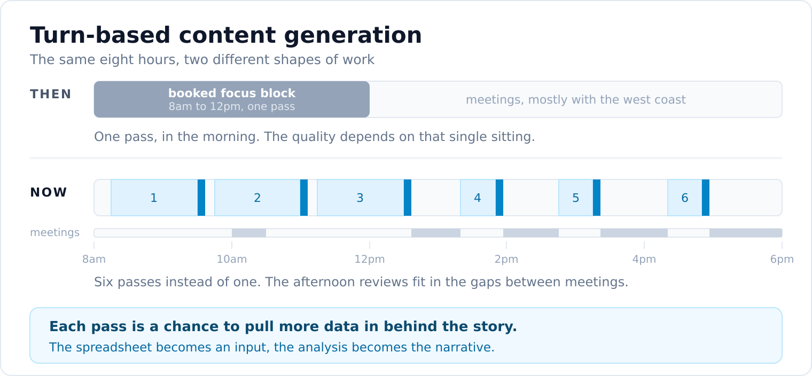

For most of my career, producing something substantial was an event. An executive deck. A detailed model. A briefing document. You found the time, you blocked the calendar, and you went heads down. Two hours, maybe four. The calendar invite was the commitment, and the quality of the output depended heavily on how well I could hold the entire story in my head while I was building it.

That model has two obvious problems. The first is that a four hour block is genuinely hard to find. The second is that my best thinking about a deliverable rarely happens while I am building it. It happens in the shower, in the car, or halfway through a meeting about something else entirely.

What has changed for me is that I work in turns now, instead of in one long block. Here is what a day looks like.

**Turn #1**: Before my first meeting of the day, I throw a prompt at [Copilot](https://copilot.microsoft.com/). Here is the deck I need, here is the audience, here is the outcome I am after, and here are the source files. Then I walk away and go do my actual job.

**Turn #2**: Between meetings I review what came back. Some of it is good. Some of it is confidently wrong. I redirect, I ask for a different structure, I point it at another data set, and then I leave it alone again.

**Turn #3**: Repeat. By the end of the day I have been through six or eight of these, and what I have is no longer a first draft. It is a shippable product.

The thing that makes this work is not the writing. It is the data. Being able to drop a spreadsheet into the conversation and have it treated as an input, something to run analysis against and pull narrative from, is the closest thing to a superpower I have found in this space. The deck I walk into the room with is backed by real numbers, and the story I tell is backed by the analysis.

It also lets me integrate deep expertise without bogging down the human subject matter experts on my team. I am not a data analyst, and I am not an expert on everything my clients care about. But I can now put together executive level storytelling that is backstopped by work that looks like both.

A few honest caveats, because there always are.

The thinking is still mine. Turns do not replace judgement, and the review step is real work. If I stop paying attention for a couple of turns, I get a confident pile of nothing that reads beautifully.

And I still have to know what good looks like. The tool will happily produce something plausible. Plausible is not the same as correct, and it is not the same as persuasive either. The difference is the audience. The model does not know the room I am walking into, which parts of the story are going to land, or which parts I am going to have to defend. It can build the content. Leading the storytelling is still my job.

What I am confident about is the productivity. Not because I type faster, but because I removed the biggest constraint on the work, which was finding a block of time large enough to do it in. I iterate in the gaps that already exist in my day, and the quality goes up as a side effect of the number of passes.

:vulcan_salute:
